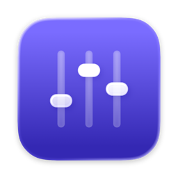
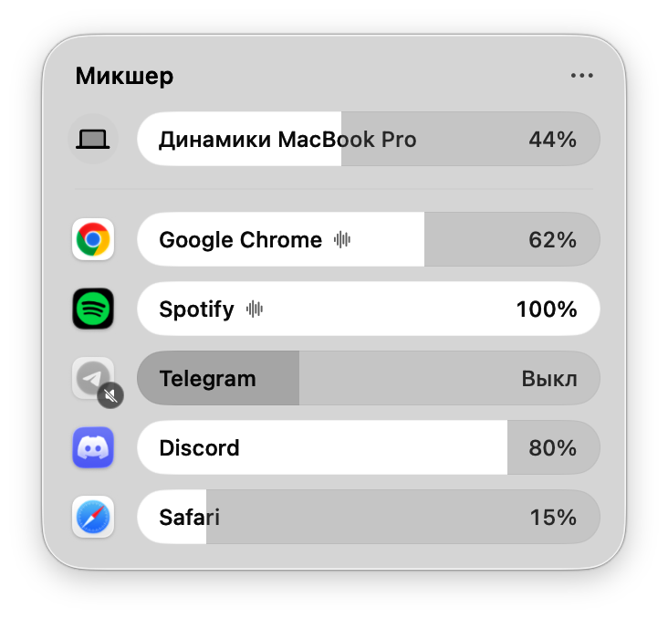

<div align="center">



# Микшер

**Громкость каждого приложения прямо из строки меню macOS**<br>
и казахская клавиатура с автозаменой: пишешь русскими буквами, получается правильный казахский

[](https://github.com/Bexull/mikser/releases/latest)


[](https://github.com/Bexull/mikser/actions/workflows/tests.yml)
[](LICENSE)

<picture>
  <source media="(prefers-color-scheme: dark)" srcset="docs/images/panel-dark.png">
  
</picture>

</div>

## Что умеет

**Микшер громкости**

- Своя громкость и «без звука» у каждого приложения, которое сейчас играет.
- Громкость устройства вывода первой строкой: динамики, наушники, AirPods, колонки.
- Стеклянная панель Liquid Glass выпадает из строки меню, как Пункт управления.
- Громкость запоминается для каждого приложения.
- Работает и со звонками: например, звук Microsoft Teams можно приглушить.
- Приложения на 100% не трогаются вообще: звук перехватывается только у тех, кому громкость убавили.

**Казахская клавиатура**

- Раскладка «Русская + Қазақша»: обычная «Русская – ПК» с цифрами плюс казахские буквы.
  Хватает двух языков: ABC и этой раскладки.
- Казахские буквы на правом ⌘ (левый ⌘ остаётся для сочетаний клавиш) или на ⌥.
- Автозамена: набираешь без казахских букв, и слова исправляются сами.

| Набираешь | Получается |
|---|---|
| сиздерди шакырамыз | сіздерді шақырамыз |
| Салеметсизбе | Сәлеметсіз бе |
| мен бир жакка баргым келип тур | мен бір жаққа барғым келіп тұр |
| айтасынба | айтасың ба |
| ата ана | ата-ана |
| нягып уйттин | неге үйттің |
| Карлыгаш, Узынагашка барамын | Қарлығаш, Ұзынағашқа барамын |
| Привет, Айгерим, как дела? | Привет, Айгерим, как дела? *(русский текст не трогается)* |

Всё работает на самом Маке. В интернет ничего не уходит, звук никуда не записывается.

## Установка

Нужны **macOS 26 Tahoe** и Mac на **Apple silicon** (M1 и новее).

1. Скачайте `Mikser-1.0.zip` со страницы [последнего выпуска](https://github.com/Bexull/mikser/releases/latest)
   и откройте архив.
2. Перетащите «Микшер» в папку «Программы».
3. Разрешите первый запуск. Приложение не нотаризовано Apple, поэтому macOS его остановит.
   Откройте Микшер, нажмите «Готово», затем «Системные настройки» → «Конфиденциальность
   и безопасность» → внизу «Всё равно открыть». Или одной командой в Терминале:

   ```bash
   xattr -dr com.apple.quarantine /Applications/Микшер.app
   ```

4. В строке меню появится значок с ползунками. Когда вы первый раз убавите громкость
   приложения, macOS попросит разрешение «Запись системного аудио». Оно нужно, чтобы менять
   громкость чужого звука; сам звук никуда не записывается.

Чтобы Микшер запускался сам: правый клик по значку → «Открывать при входе в систему».

## Как пользоваться

- **Клик по значку** открывает панель. Тяните полоску, чтобы изменить громкость; клик по иконке
  приложения выключает и включает его звук.
- **Правый клик по значку** или «⋯» в панели: автозапуск, «Вернуть всем 100%»,
  настройки казахской клавиатуры.

## Казахская клавиатура

### Включить

1. Правый клик по значку → «Казахская клавиатура» → «Установить раскладку «Русская + Қазақша»».
   Она встанет вместо «Русская – ПК».
2. Там же «Дать доступ к клавиатуре…». Правому ⌘ и автозамене нужен «Универсальный доступ»:
   Системные настройки → Конфиденциальность и безопасность → Универсальный доступ → Микшер.
3. Перезапустите программы из App Store, которые были открыты (Teams, Telegram, WhatsApp,
   Outlook), иначе в них новая раскладка не выбирается. Проще всего выйти из системы и войти
   снова: заодно включится казахский словарь проверки орфографии.

### Казахские буквы

Правый ⌘ (или ⌥) и клавиша русской буквы; с ⇧ получаются заглавные.

| Клавиша | а | и | н | г | к | о | у | ц | х |
|---|---|---|---|---|---|---|---|---|---|
| **с правым ⌘** | ә | і | ң | ғ | қ | ө | ү | ұ | һ |

### Автозамена

- Слово исправляется, когда нажимаете пробел или знак препинания.
- Сначала определяется язык фразы: русские слова и имена в русском тексте остаются как есть.
- Разговорное пишется правильно: «нестимиз» → «не істейміз», «нягып» → «неге»,
  «білмимін» → «білмеймін». Разговорные окончания остаются: «жатсың», «боп», «қып».
- Аббревиатуры («ӘКК», «АҚШ») исправляются, только если набраны заглавными: «акк» в
  переписке остаётся аккаунтом.
- **Отменить:** ⌫ два раза сразу после исправления. Первый ⌫ стирает только пробел, так что
  можно дописать «!» или «?».
- **Обучение:** если дважды набрать казахскими буквами слово, которого нет в словаре, Микшер
  его запомнит. Сбросить: «Забыть выученное».
- **Свои слова:** «Мои слова для автозамены…» открывает файл, куда можно вписать свои написания.
- В терминалах, редакторах кода и менеджерах паролей автозамена выключена. В любой другой
  программе её можно выключить пунктом «Не исправлять в «…»».

Слово исправилось неправильно? [Расскажите](https://github.com/Bexull/mikser/issues/new?template=word.yml),
так автозамена становится точнее.

## Частые вопросы

<details>
<summary>macOS пишет, что приложение повреждено или его нельзя открыть</summary>

Так Gatekeeper встречает приложения, не нотаризованные Apple. Выполните в Терминале
`xattr -dr com.apple.quarantine /Applications/Микшер.app` или разрешите запуск в
«Конфиденциальность и безопасность».
</details>

<details>
<summary>В Teams или Telegram печатается только по-английски</summary>

Программы из App Store хранят свою копию списка раскладок. Если она сделана до установки
«Русская + Қазақша», новой раскладки в ней нет. Микшер удаляет такие копии сам; закройте
программу полностью (⌘Q) и откройте снова.
</details>

<details>
<summary>Приложения нет в панели</summary>

В панели только приложения, которые сейчас воспроизводят звук. Включите в нём звук,
и оно появится.
</details>

<details>
<summary>Автозамена не работает</summary>

Проверьте, что выбрана раскладка «Русская + Қазақша» (автозамена работает только в ней),
что у Микшера есть «Универсальный доступ» и что программа не в списке «Не исправлять в…».
</details>

<details>
<summary>Как удалить</summary>

Выйдите из Микшера (правый клик по значку → «Выйти») и удалите его из «Программ».
Чтобы убрать и клавиатуру:

```bash
rm -rf ~/Library/Keyboard\ Layouts/RussianKazakh.bundle ~/Library/Spelling/kk.dic ~/Library/Spelling/kk.aff
defaults delete com.bexul.mixer
```

Затем верните «Русская – ПК»: Системные настройки → Клавиатура → Источники ввода.
</details>

## Сборка из исходников

Нужны macOS 26 и Xcode 26.

```bash
git clone https://github.com/Bexull/mikser.git
cd mikser
./build.sh --install
```

- `./build.sh` только собирает `build/Микшер.app`, `--install` ставит в «Программы»,
  `--release` ещё и пакует `build/Mikser-<версия>.zip`.
- Без сертификата сборка подписывается ad hoc, и после каждой пересборки macOS заново
  спрашивает разрешения. Чтобы не спрашивала, положите хэш своего сертификата Apple Development
  (из `security find-identity -v -p codesigning`) в файл `.sign-identity` или в переменную
  `MIXER_SIGN_IDENTITY`.

## Как устроено

- `Sources/AppTap.swift`: перехват звука одного приложения (Core Audio process tap) →
  приватное aggregate-устройство → IOProc с громкостью → устройство вывода.
- `Sources/MixerModel.swift`: какие приложения сейчас со звуком, сохранённые громкости,
  устройство вывода, общая громкость.
- `Sources/MixerView.swift`, `Sources/PanelController.swift`: интерфейс и стеклянная панель
  под значком в строке меню.
- `Sources/KazakhKeyboard.swift`: перехват клавиатуры (правый ⌘ и автозамена), обучение,
  исключённые программы.
- `Sources/KazakhTyping.swift`: сама автозамена. Решает, как должно выглядеть каждое слово,
  по словарю, соседним словам и языку фразы.
- `Sources/KazakhLayout.swift`, `Resources/RussianKazakh.bundle`: раскладка и её установка.
- `Resources/kazakh/`: словарь автозамены, собранный из корпусов скриптом
  `Tools/make-kazakh-dictionary.py`.
- `Resources/AppIcon.icon`: иконка Liquid Glass (открывается в Icon Composer).

Как исследовались и проверялись правила автозамены:
[docs/kazakh-autocorrect-research.md](docs/kazakh-autocorrect-research.md),
[docs/kazakh-colloquial-analysis.md](docs/kazakh-colloquial-analysis.md).

## Разработка

**Тесты автозамены** (они же запускаются на GitHub при каждом изменении):

```bash
swiftc -O -o build/test-typing Tools/TypingTests/main.swift \
  Sources/KazakhTyping.swift Sources/KazakhWords.swift Sources/KazakhLexicon.swift
build/test-typing Resources/kazakh Tools/TypingTests/chat-phrases.tsv Tools/TypingTests/russian-phrases.tsv
```

`holdout-*.tsv` — фразы, на которых правила не настраивались, `colloquial.tsv` — разговорные
формы. Любое изменение русского текста считается ошибкой. Проверка на 3000 настоящих отзывах:
`Tools/make-review-test.py` делает набор из тестовой части KazSAnDRA, `Tools/ReviewTest`
считает, сколько слов восстановлено.

**Пересборка словаря.** Скачайте корпуса из раздела «Данные» и выполните:

```bash
python3 Tools/make-kazakh-dictionary.py Resources/kazakh \
    --words kaz_newscrawl_2016_1M-words.txt --sentences kaz_newscrawl_2016_1M-sentences.txt \
    --russian ru_full.txt Tools/russian-kazakhstan.txt --subtitles kk_full.txt \
    --informal 01_pc_train_ib.csv 04_pc_valid.csv \
    --chat Tools/kazakh-chat-words.txt --phrases Tools/kazakh-phrases.txt --joins Tools/kazakh-joins.txt \
    --spoken Tools/kazakh-spoken.txt
```

Ручные списки в `Tools/`: разговорные слова, устойчивые фразы, слитные слова, русские слова
Казахстана, разговорные формы. Раскладка пересобирается так:
`swiftc -o build/make-keyboard-layout Tools/make-keyboard-layout.swift && build/make-keyboard-layout Resources/RussianKazakh.bundle`.

**Отладка.**

- `Mixer --snapshot <папка>` рисует панель в PNG, светлую и тёмную.
- `Mixer --capture <папка> [light|dark]` открывает настоящую панель и снимает её окно с тенью.
- `pkill -USR1 -f Микшер.app/Contents/MacOS/Mixer` записывает состояние движка в
  `~/Library/Logs/Mixer/state.txt`.

## Данные

Словарь автозамены собран из открытых корпусов:

- [Leipzig Corpora Collection](https://wortschatz.uni-leipzig.de/en/download), `kaz_newscrawl_2016_1M`:
  казахские новости, CC BY (Goldhahn, Eckart, Quasthoff, LREC 2012).
- [FrequencyWords](https://github.com/hermitdave/FrequencyWords) (Hermit Dave): частотные
  списки по субтитрам OpenSubtitles, CC BY-SA 4.0.
- [KazSAnDRA](https://github.com/IS2AI/KazSAnDRA) (ISSAI): неформальные казахские отзывы, CC BY 4.0.

Спасибо авторам этих корпусов.

## Лицензия

Код распространяется по лицензии [MIT](LICENSE), данные автозамены в `Resources/kazakh` — по
[CC BY-SA 4.0](Resources/kazakh/LICENSE.md).

---

### In English

**Mikser** is a menu bar app for macOS 26 (Apple silicon). It sets the volume of each app
separately in a Liquid Glass panel, using Core Audio process taps. It also ships a combined
Russian + Kazakh keyboard layout and an on-device autocorrect that turns Kazakh typed with plain
Russian letters into proper Kazakh spelling, while leaving Russian text alone. Download the
latest build from [Releases](https://github.com/Bexull/mikser/releases/latest); the app is not
notarized, so run `xattr -dr com.apple.quarantine /Applications/Микшер.app` after installing.
Code: MIT. Autocorrect data: CC BY-SA 4.0.
